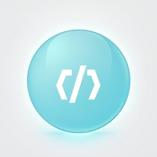

 <p align="center">
  
</p>

<h1 align="center">GlassScope Studio</h1>

<p align="center">
  <strong>See Through Software.</strong>
</p>

<p align="center">
  A Reverse Engineering & Static Analysis Studio for Kali Linux
</p>

<p align="center">
  
  
  
  
  
</p>

---

## Overview

GlassScope Studio is a Python-based reverse engineering and static analysis application developed for Kali Linux.

It provides a unified graphical environment for inspecting software binaries, executable files, mobile application packages, firmware images, documents, data stores, and web-related artifacts.

Designed with a modular architecture, GlassScope combines multiple analysis capabilities into one application, allowing security researchers, developers, and students to examine software structures and extract useful technical information.

The application supports both a graphical interface and headless command-line scanning, with structured JSON output for automated analysis workflows.

## Core Capabilities

| Category | Capabilities |
|---|---|
| Binary Analysis | ELF, PE, Mach-O |
| Reverse Engineering | Disassembly, architecture detection |
| Android | APK, DEX, JAR |
| Apple | Mach-O, IPA |
| .NET | Managed binaries, IL2CPP metadata |
| Electron | ASAR archive analysis |
| Firmware | DTB, FIT, U-Boot, ESP, IPS |
| File Analysis | Strings, hex dump, entropy |
| Cryptography | Crypto identification, XOR, embedded keys |
| Hashing | File hashes, fuzzy hashes, imphash, symbol hash |
| Threat Analysis | IOC scanning |
| Documents | PDF, OLE, OOXML |
| Data Stores | SQLite, registry |
| Web Analysis | JavaScript and website inspection |

## Interface

GlassScope Studio includes 22 dedicated navigation sections.

- Overview
- Binary Inspector
- Bytes & Strings
- Disassembler
- PE Inspector
- Mach-O & iOS
- ASAR & Electron
- Android & Java
- Java Classes
- .NET & Managed
- Firmware & Formats
- Hash Lab
- Binary Diff
- IOC Hunter
- Crypto Lab
- Document Triage
- Data Stores
- JavaScript Scan
- Website Scan
- Toolbox
- Evidence Log
- About

## Architecture

GlassScope follows a modular architecture with three main components.

**1. Core Engine**

`glassscope_core/`

Contains the analysis modules, parsers, hashing utilities, format detection, and scanning functionality.

**2. Graphical Interface**

`glassscope_gui/`

Contains the Tkinter application interface, navigation pages, theme configuration, and reusable widgets.

**3. Application Launcher**

`glassscope.py`

Handles application startup, platform verification, version information, scanner registration, and command-line execution.

## Installation

### Requirements

- Kali Linux
- Python 3
- Python Tkinter
- Git
- Graphical desktop environment for GUI usage

### Step 1 — Update Packages

```bash
sudo apt update
```

### Step 2 — Install Dependencies

```bash
sudo apt install python3 python3-tk git -y
```

### Step 3 — Clone Repository

```bash
git clone https://github.com/ethical-tool/GlassScope.git
```

### Step 4 — Enter Application Directory

```bash
cd GlassScope/GlassScope
```

### Step 5 — Install GlassScope

```bash
chmod +x install.sh
sudo ./install.sh
```

### Step 6 — Launch Application

```bash
glassscope
```

After installation, GlassScope Studio can also be launched from the Kali Linux Applications menu.

## Running Without Installation

To launch directly from the project directory:

```bash
cd GlassScope/GlassScope
python3 glassscope.py
```

A graphical desktop session is required for the GUI.

## Command-Line Interface

GlassScope includes a headless scanning mode that can execute individual analysis modules without opening the graphical interface.

### Display Version

```bash
glassscope --version
```

### List Available Scanners

```bash
glassscope --list-scans
```

### Run a Scan

General syntax:

```bash
glassscope --scan MODULE TARGET
```

### Save Results as JSON

```bash
glassscope --scan MODULE TARGET --out result.json
```

### Supported Scanner Modules

The following module names are registered in the current launcher:

```text
android
apk
asar
carve
class
crypto
dex
disasm
dotnet
elf
entropy
firmware
formats
fuzzy
gobuild
hashes
hexdump
il2cpp
imphash
iocs
ipa
jar
keys
macho
ooxml
ole
pdf
pe
registry
sqlite
strings
symhash
wasm
xor
```

### Example Commands

Inspect an ELF binary:

```bash
glassscope --scan elf sample.elf
```

Analyze a Windows executable:

```bash
glassscope --scan pe sample.exe
```

Inspect an Android package:

```bash
glassscope --scan apk application.apk
```

Extract strings:

```bash
glassscope --scan strings sample.bin
```

Generate file hashes:

```bash
glassscope --scan hashes sample.bin
```

Analyze file entropy:

```bash
glassscope --scan entropy sample.bin
```

Export analysis:

```bash
glassscope --scan elf sample.elf --out analysis.json
```

## Project Structure

```text
GlassScope/
│
├── README.md
├── LICENSE
├── logo.png
│
└── GlassScope/
    │
    ├── glassscope.py
    ├── install.sh
    ├── uninstall.sh
    ├── BUGFIXES.md
    │
    ├── assets/
    │   ├── logo.png
    │   ├── logo_raw.png
    │   ├── logo_64.ppm
    │   ├── icon_64.png
    │   └── icon_128.png
    │
    ├── glassscope_core/
    │   ├── android.py
    │   ├── asar.py
    │   ├── bytescan.py
    │   ├── cryptolab.py
    │   ├── diffmod.py
    │   ├── disasm.py
    │   ├── documents.py
    │   ├── dotnet.py
    │   ├── efuses.py
    │   ├── elf.py
    │   ├── firmware.py
    │   ├── formats.py
    │   ├── har_cap.py
    │   ├── hashing.py
    │   ├── iocs.py
    │   ├── jclass.py
    │   ├── jscan.py
    │   ├── macho.py
    │   ├── pe.py
    │   ├── registry.py
    │   ├── report.py
    │   ├── sqlitefs.py
    │   ├── toolbridge.py
    │   ├── util.py
    │   └── webscan.py
    │
    ├── glassscope_gui/
    │   ├── app.py
    │   ├── pages.py
    │   ├── pages2.py
    │   ├── theme.py
    │   └── widgets.py
    │
    └── patches/
        └── rea-bugfixes.patch
```

## Uninstallation

Run the included uninstaller:

```bash
sudo /opt/glassscope/uninstall.sh
```

This removes the installed application, command-line launcher, desktop entry, icon, and installation directory.

## Bug Fixes

The project includes a separate `BUGFIXES.md` document describing four verified upstream REA CLI bug fixes.

The documented fixes address:

- Missing or empty output-filter slice bounds.
- Incorrect handling of negated non-boolean flags.
- Version shortcut handling.
- Incorrect JSON error reporting for certain missing file paths.

See [BUGFIXES.md](GlassScope/BUGFIXES.md) for technical details.

## License

GlassScope Studio is distributed under the MIT License.

See the [LICENSE](LICENSE) file for the complete license terms.

## Responsible Use

GlassScope Studio is intended for legitimate reverse engineering, software inspection, educational activities, and authorized security research.

Use the application only on software and systems you own or have explicit permission to analyze.

The project is provided without warranty. Users are responsible for ensuring that their activities comply with applicable laws and regulations.

---

<p align="center">
  
</p>

<h3 align="center">GlassScope Studio</h3>

<p align="center">
  <strong>See Through Software.</strong>
  <br>
  Explore. Analyze. Understand.
</p>

<p align="center">
  <a href="https://github.com/ethical-tool/GlassScope">GitHub Repository</a>
</p>
